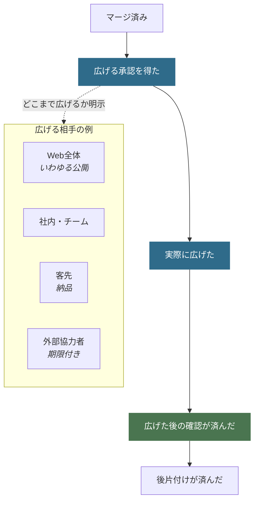

# CLI・AI連携の詳細

[README](../README.md)の補足です。以下のコマンドは、このツールのcheckout直下で実行します。

## 使い方

**利用（検査だけ）**に必要なのは Python 3.9 以降と Git だけです。追加のパッケージはありません。

```bash
git clone https://github.com/nexus-ai-2045/repo-preflight.git
cd repo-preflight
python scripts/readiness_scan.py --repo /path/to/your-repo
```

`.repo-preflight-consistency.json` に impact_map がある repo では、整合性検査に差分の scope が要ります。最短コマンドでは未指定時に `origin/main` を既定候補として使います（usable な remote base で、HEAD の祖先であること）。別の比較元にしたいときだけ `--consistency-base-ref` を付けます。repo 全体 scan（secret・個人path・必須文書）は狭めません。

調べたいリポジトリは、このツールとは別の場所にあってかまいません。中身は読むだけで、書き換えません。

**開発・テスト・CI**では `pip install -e ".[test]"` が必要です。手順は [CONTRIBUTING.md](../CONTRIBUTING.md) を参照してください。

### PRレビューの収束確認

GitHub CLIで認証済みの環境では、CI、review、inline threadを同じPR HEADへ束縛して確認できます。

```bash
python scripts/github_pr_review_snapshot.py \
  --repo owner/name \
  --pr 123 \
  --expected-head <40文字のcommit SHA> \
  --required-reviewer chatgpt-codex-connector \
  --grace-seconds 30
```

通常コメント、review概要、CI、GraphQL review threadを別々のsurfaceとして読みます。HEAD不一致は
`tool_error`、未解決threadやCI失敗は`blocked`、review待ちやCI実行中は`pending`です。
`pass`はreview snapshotの機械検査結果であり、merge承認ではありません。

### 結果の読み方

同じ CLI でも、返す JSON の schema と `status` 語彙が分かれます。混ぜて読まないでください。

| モード | いつ | schema | `status` |
|---|---|---|---|
| 検査 | `--repo` のみ、または CI | `repo-preflight.scan/v3` | `pass` / `blocked` / `tool_error` |
| 対話 | `--intent` 指定時 | `repo-preflight.dialogue/v3` | `needs_human_input` / `blocked` / `ready_after_confirmation` |
| 抑止記録 | `--record-dismissal` | `repo-preflight.preferences/v1` | `recorded` |

検査モード:

| 返る値 | 意味 | 次にすること |
|---|---|---|
| `pass` | 機械の範囲では引っかからなかった | 中身と見せる相手を人が決める |
| `blocked` | 直すべき点がある | 指摘に対応してもう一度実行する |
| `tool_error` | Gitやファイルを十分に読めなかった | この結果を判断に使わない |

対話モード（詳細は [SKILL.md](../SKILL.md)）:

| 返る値 | 意味 | 次にすること |
|---|---|---|
| `needs_human_input` | 質問や設定確認が残っている | 人に聞いてから外への操作をしない |
| `blocked` | secret 等で fail-closed | 無視して進まず、修復方針を聞く |
| `ready_after_confirmation` | 機械不足は埋まっている | 最終確認のあと intent 準備へ |

読めなかったものを「問題なし」とは言いません。**判断がつかないときは、通さない側に倒します。**

## AIエージェントから使う

AI用skillは、エージェントが次の操作へ進む**直前**に検査を呼ぶための手順です。実際に呼ばれたかは、対象エージェントの実行記録で確認してください。


GitHub を採用するとき（リポジトリ作成・最初の push・PR・merge）の契約は、この `--intent` 対話です。cloneしただけ、GitHubのページを開いただけでは対話は走りません。`--intent`を付けると`repo-preflight.dialogue/v3`の確認事項が生成されます。呼出側は未確認・失敗の結果を受けたら外部操作を中止する必要があります。CLI自身が他のプロセスを停止したり、GitHub.comを対話画面に変えたりする機能はありません。

```bash
python scripts/readiness_scan.py --repo PATH --intent <場面> --human
```

| 場面 | `--intent` | 追加引数 | 主に確認すること |
|---|---|---|---|
| リポジトリを新しく作る | `create_repo` | `--repo` 不要 | 公開範囲、最初の文書、名義 |
| push する | `push` | `--base-ref origin/比較元` | 今回の変更、履歴、未コミット |
| PR を作る | `open_pr` | `--base-ref origin/比較元` | 差分、文書とテストの追随 |
| マージする | `merge` | `--base-ref origin/比較元` | 統合前の残作業と人の確認 |
| GitHub Settings の変更準備 | `configure_settings` | `--github-settings-profile` | remote設定の実測とpreview |
| 共有・納品・公開 | `publish` | `--audience public` など | 見せる相手、全履歴、権利 |
| リリース準備 | `release` | なし | READMEの情報設計と運用記録 |

返ってくるのは**質問リスト**です。エージェントはそれを人へ番号付きで見せ、答えが返るまで外部への操作をしません。

`configure_settings` は `gh api` のGETだけで remoteを実測し、`solo_public` / `team_public` / `high_risk_public` と比較します。認証account、複数rulesetの累積効果・bypass、required check名、default/advanced CodeQLを分けて確認し、設定候補は一件ずつ現在値・推奨値・外部影響・rollback・API操作previewを返します。**設定変更は実行しません。** 403 / 404 / plan制約は `false` とみなさず `unavailable` にします。

```bash
python scripts/readiness_scan.py --repo PATH --intent configure_settings \
  --github-settings-profile solo_public --human
```

**認証情報や個人のパスが見つかったときは、「無視して進む」という選択肢を出しません。**

範囲の絞り込み、同じ質問を次回から出さない設定、GitHub設定ガイドの鮮度は [intent 対話の運用オプション](intent-dialogue-options.md) にあります。

## 文書とコードのずれ

`.repo-preflight-consistency.json` を置くと、リンク切れ・READMEに書いたコマンドと実体のずれ・コード変更に文書やテストが追随していない箇所・生成物の古さを調べます。**何を守るかは各リポジトリが宣言し、調べる仕組みはこのツールが持ちます。**

| 段階 | ふるまい |
|---|---|
| `shadow` | 調べるが止めない。まず実態を知る |
| `ratchet` | 今ある分は通し、**新しく増えた分だけ**止める |
| `enforce` | 引っかかったら止める |

`ratchet` は締める方向にしか進みません。問題が減ったときは、見逃す枠も一緒に縮めます。

このリポジトリ自身は `enforce` に固定し、CIで毎回検査しています（ubuntu / macOS は Python 3.9・3.11・3.13、Windows は 3.13 のみ）。設定を消したり段階を下げたりすると、CIが失敗します。設定例は [リポジトリ整合性ゲート](repository-consistency-gate.md)、設計判断は [ADR一覧](adr/README.md)、実行環境は [docs/runtime-support.md](runtime-support.md) です。

加えて、trackedなのにignore対象でもあるpathの新規増加は、原本のまま同梱したrelease wheelとSHA-256を`requirements-tools.txt`で固定した `ai-ratchet-gate` v0.1.1とreview済みbaselineを使って全CI jobで止めます。baselineの作成・拡大・縮小は人間レビュー対象です。

持ち主の個人名義を人に書かせずに照合する `scripts/local_identity_guard.py` の使い方は [docs/local-identity-guard.md](local-identity-guard.md) を参照してください。

名義・共同作者行・コミット本文の `identity_gate` も必須判定です。非公開設定 `PREFLIGHT_PRIVATE_PATTERNS_FILE` または `PREFLIGHT_PRIVATE_PATTERNS` が欠ければ停止します。型・正規表現・入力ファイルが不正な場合は、値を出さず検査不能として止めます。通常は全参照、差分操作は指定した比較元以降の全コミットを検査します。リリース時の `--identity-base-ref` は名義だけを今回範囲へ限定し、本文の全参照検査を狭めません。設定や個人名義をプルリクエスト・チャットへ貼らないでください。

`REDACTED`という伏せ字は、作者・コミッター・共同作者等の登録名義として拒否します。ログの伏せ字表示と、Gitに保存する名義は別です。非公開設定の`deny_email_sha256s`には、メールを前後の空白除去・大小文字の正規化後にSHA-256へ変換した値を登録できます。禁止メールの判定は許可リストより優先し、表示名を変えても拒否します。ハッシュは匿名性の保証ではなく、公開設定へ個人の照合値を載せないための入力形式です。禁止リスト自体も非公開で管理してください。

操作intentでは、名義検査に加えて正規化した個人識別子・履歴object・ファイル名も `private_identity_scan` で検査します。`PUBLIC_IDENTITY_DENYLIST` には、検査対象の外で管理する非公開UTF-8リストの絶対パスを指定してください。検出器は同梱の正本を使い、別の採用済み検出器を指定する場合だけ `PUBLIC_IDENTITY_GUARD_SCRIPT` を渡します。入力不足・内容変更・検査不能は停止し、報告には値を含めず入力のhashと検査状態を記録します。

同梱の検出器を使うとき、作業treeの本文検査で合格した内容はSHA-256だけを `${XDG_CACHE_HOME:-~/.cache}/repo-preflight/identity-scan/`（ディレクトリ0700・ファイル0600）に控え、次回から同じ内容の本文検査を省きます（ファイル名の検査は毎回行い、報告の `worktree_files_cache_reused` に省いた数が出ます）。検査器・方針・正規化器・reviewed例外・remote・Pythonのどれかが変わる、控えが壊れている、repo内にある、のいずれかなら全体を読み直します。控えのフォルダの権限が0700より緩いときは自動で直さず、控えを読みも書きもしません（直すときは手で `chmod 700` してください）。控えを使わないときは `REPO_PREFLIGHT_IDENTITY_SCAN_CACHE=off` を渡します。控えには署名が無く、同じユーザーの権限で動くコードは書き換えられるため、CIでキャッシュのフォルダを復元・共有する設定や、信頼できないPRを検査するジョブでは `REPO_PREFLIGHT_IDENTITY_SCAN_CACHE=off` にしてください。

このリストと名義用の `PREFLIGHT_PRIVATE_PATTERNS_FILE` のJSONは、責務と形式が異なります。名義・共同作者行を確認する既存gateと、正本の正規化検査を両方通してください。非公開のリストやJSONを公開リポジトリへコピーしないでください。

共通CIと`preflight_ratchet.py`は、既定で`references/public-commit-identities.json`を使い、作者・コミッター・共同作者等を検査します。伏せ字や許可外の名義は`public_attribution`で失敗し、件数の基準値では免除しません。別の運用名義を使う導入先は、レビューした一覧を`--allowed-identities IDENTITIES.json`で明示してください。

開発道具が本文へ付ける `Claude-Session` 行と、Claude Code のセッションURLも止めます。コミット本文は `public_attribution` と `identity_gate`、PR題名・本文・コメントは `identity_gate.py` のPRイベント検査、ファイルの中身は `secret_scan`（規則 `claude_session`）で数えます。値は出しません。

## CIから使う

`--repo` だけを渡すと、質問をせずに検査結果だけを返します。CIから使うときはこの形です。

変更差分を見る設定（`impact_map` や生成物）がある場合、比較元が要ります。最短コマンドでは未指定時に `origin/main` を試し、usable ならそれを使います。完全な初期コミット1件だけの場合は、全追跡ファイルを初期変更として検査します。それ以外でusableな比較元がなければ止まります。浅いcloneを初期履歴とは扱いません。

差分へ絞るときは **`--base-ref`** を使います。CLI に `--target-diff` フラグはありません。

private repositoryへのコミット済み送信だけを検査する場合は、明示的に次を指定します。

```bash
python scripts/readiness_scan.py --repo PATH --intent open_pr --base-ref origin/main --private-submission
```

`--private-submission` は `push` / `open_pr` / `merge` 専用です。GitHub APIで現在のprivate状態とlive base SHAの完全一致を確認し、実効push先も同じrepositoryの単一URLと検証します。public・不明・API失敗・比較元不一致は `tool_error` です。credential入りURLも拒否します。

この明示モードは `base..HEAD` で導入されたcommit/tree/blobのraw bytesを検査します。中間commitで削除された内容、commit metadata、変更entryの名前と改名も含みます。変更していないbaseline blobと未送信のdirty・未追跡本文は内容検査しません。clean-worktreeと整合性のgateは残るため、dirtyなら別の理由で止まります。結果の `scan_scope.mode=private_committed_submission` とbase/head SHA・live private確認は今回の範囲の証拠であり、repository全体の検査証明ではありません。treeの構造・OIDは検証しますが、変更していない兄弟entry名は再判定しません。

`--base-ref` だけの既定動作、public・full・publish・releaseの検査、形式・容量制限、キャッシュ方針は変わりません。公開・releaseへこの限定を流用しないでください。

### 主な引数

| 引数 | 何をするか |
|---|---|
| `--intent <場面>` | 操作の直前ゲート（対話 schema） |
| `--repo <パス>` | 調べる対象。新規作成のときだけ不要 |
| `--private-submission` | live確認済みprivate repositoryへのコミット済み送信だけを検査（`--base-ref` 必須） |
| `--base-ref <比較元>` | 今回の変更へ絞る（`push` / `open_pr` / `merge`） |
| `--consistency-base-ref <比較元>` | 文書チェックだけ差分に絞る（未指定時は `origin/main` を試す） |
| `--expected-identity "<名前> <メール>"` | 全コミットの名義を確認する |
| `--allowed-identities <JSON>` | レビュー済みの公開許可名義を照合する |
| `--require-private-identity` | 通常検査でも非公開の個人識別子検査を必須にする（操作intentでは既定で必須） |
| `--identity-base-ref origin/main` | releaseに限り、明示したremote ref以降の今回コミット名義を照合し、既存全履歴の名義不一致件数を別に報告する |
| `--audience <相手>` | 見せる相手を指定する |
| `--github-settings-profile <profile>` | Settings比較profile |
| `--human` | 質問は人向け、結果は機械向けに分ける |
| `--release` | READMEの情報設計チェックも走らせる |
| `--interactive` | コンソール補助（本体ではない） |
| `--record-dismissal <id>` | 推奨質問の抑止を記録して終了 |
| `--dismissal-mode` | `7d` / `30d` / `90d` / `forever` |
| `--dismissal-reason` | 抑止理由（任意） |

対話 UI の「次から出さない」は主に `30d` / `90d` / `forever` です。CLI は `7d` も受け付けます。

### 終了コード

| 値 | 意味 |
|---|---|
| `0` | 検査 `pass`、対話 `ready_after_confirmation`、または抑止 `recorded` |
| `1` | 検査 `blocked`、または対話の `needs_human_input` / `blocked` |
| `2` | 検査そのものが失敗した（`tool_error`） |

このツールは既定で読むだけです。リポジトリ作成、push、PR、マージ、投稿は行いません。公開範囲の変更は公開コマンド `scripts/publish_gate.py` の `--apply` だけです。各リポジトリの CI から1行で呼ぶ共通ゲートとラチェットは [公開コマンドと共通CIゲート](publish-and-ci-gate.md) にあります。

## 見せる相手を広げるとき

公開だけが終点ではありません。社内共有、客先納品、外部協力者への一時提供でも、**承認 → 実際に広げる → 広げた後の確認**は同じです。



公開なら「外から見えるファイルと全コミット履歴」、チーム共有なら「権限を持つ人の一覧」、外部協力者なら「与えた権限と、いつ切れるか」が証拠になります。非公開のまま止めることも、PRまで、マージまでも、正式な完了地点です。詳しくは [状態一覧](../references/lifecycle.md)。

## Skill として使う

| 使う環境 | 入口 |
|---|---|
| 正本 | [SKILL.md](../SKILL.md) |
| Claude Code | [runtime/claude-code/SKILL.md](../runtime/claude-code/SKILL.md) |
| Grok | [runtime/grok/SKILL.md](../runtime/grok/SKILL.md) |
| Codex | [runtime/agents/openai.yaml](../runtime/agents/openai.yaml) |

```bash
python scripts/runtime_smoke.py --repo .
```

配り方と保証境界は [docs/runtime-support.md](runtime-support.md) です。skillは**各自がcloneしてから配布**してください。他人のskillフォルダをコピーしないでください。

公開リポジトリの保護設定は [GitHub repository設定ガイド](../references/github-settings.md)、参加の約束は [CODE_OF_CONDUCT.md](../CODE_OF_CONDUCT.md)、脆弱性報告は [SECURITY.md](../SECURITY.md) です。

## レビュー済みの限定 secret 例外

既知の誤検知を内容まで確認したときだけ、`--reviewed-secret-exceptions REVIEWED.json` を明示指定できます。通常の secret 正規表現、UTF-8/UTF-16、URL復号、作業ツリーと削除済みを含む履歴の検査は維持します。例外ファイルは自動読込せず、全束縛条件が一致した検出だけを除外します。private原資料の個人pathを扱うversion 2は、liveのprivate確認・UTC期限・人間レビュー参照を必須にします（[ADR-0006](adr/0006-private-evidence-path-exceptions.md)）。この指定は公開・push・導入の承認ではありません。キー一覧・件数集約・結果フィールド・失敗時の扱いなど詳細は [ADR-0005](adr/0005-reviewed-secret-exceptions.md) にあります。

公開fixture用version 3の条件と今回の5履歴blobの確認記録は[ADR-0008](adr/0008-public-synthetic-path-fixtures.md)を参照してください。v2のprivate限定条件は維持します。

改名などでPDF・MP3・MP4の形式宣言が追加・変更されたcommitted tree entryは、blobがbaselineに既存でも再検査します。変更していないbaseline全体は追加しません。

明示private送信では、同じpathの直前の比較親と現在commitから得たtextだけを比較します。変更text内の不変行と不変の正規化候補は再判定せず、追加本文と新しい正規化値を調べます。変更部分に依存する再構成は、同値が親の別箇所にもあっても検査します。正規表現の役割に基づく既存のmaskは保持します。新規・copy・renameで同pathの比較元が無い場合、binary・media、commit metadataは全文検査のままです。全中間commitを調べるため、途中で追加後に削除した値も対象です。外部providerで差分の同等性を証明できない場合は全文側へ倒します。

text比較は合計200万文字またはold/new行数の積1600万を上限にし、超えた変更fileだけを全文検査します。`private_identity_scan.text_delta_full_fallbacks` がその回数を記録します。不変性を証明できない候補も検査側へ倒します。公開・fullの検査方針、画像・媒体のstrict decoderと既存上限は変更しません。
