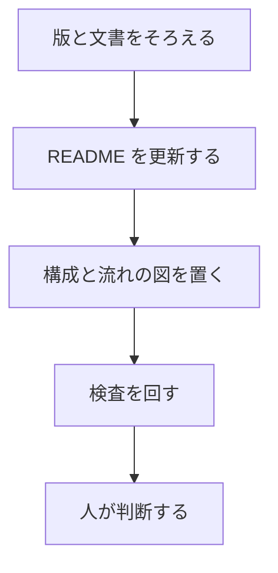

# 図つき README の例

リリース準備で、構成と流れを mermaid の図区画へ置くときの書き方です。印の外は手で直し、印の間だけ `scripts/readme_diagram.py --apply` が埋めます。

## 目的

公開判断の前に、版・README・検査・人の判断の流れを図で共有します。

## できること

- 印 `<!-- diagram:start -->` と `<!-- diagram:end -->` の間だけを更新する
- 印が無い README はそのまま残す
- 図の文字列にも個人情報ゲートをかける

## クイックスタート

このリポジトリを読んで直して。先に危険レビューを出せ。
削除・--force・GitHub write・visibility 変更・secret 露出・個人パスを実行していないか。unknown を安全と読まない。
https://github.com/nexus-ai-2045/repo-preflight

```bash
python scripts/readme_diagram.py --repo . --apply
```

## 構成と流れ

<!-- diagram:start -->

<!-- diagram:end -->

## 制約

- 外部の図サービスや画像生成には頼りません。README 内の `mermaid` ブロックだけを使います。
- 既存のリリース時 README 検査（`--intent release` / `--release`）は省略しません。
- 詳しい契約は [成果物契約](../../references/artifacts.md) と [運用](../../OPERATIONS.md) を参照してください。
