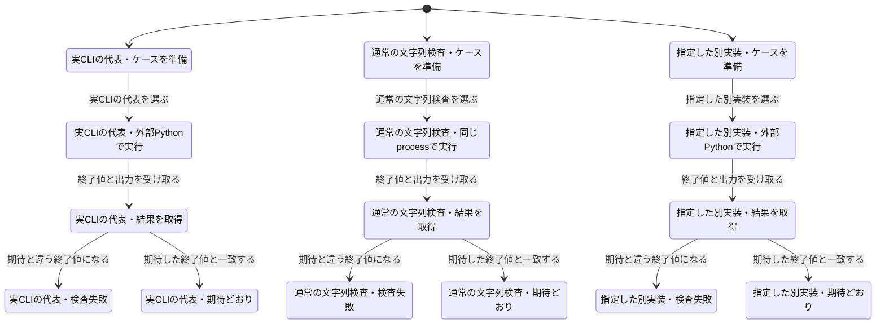

# テストの実行負荷を測る

文字列検査は、公開CLIの `main(argv)` を同じPythonプロセスで呼ぶ。引数解析、入力ファイル、policy、診断、終了値の検査は残し、ケースごとのPython起動を省く。Git境界の11ケースと、明示した `IDENTITY_GATE_SCRIPT` は実際の外部CLIで実行する。

## 保持した検査

変更前の142行は、入力全文と期待終了値で比較すると137種類だった。同じ全文・同じ期待値の5行だけを除いた。異なる表記や異なる入力をまとめて削除していない。既存137種類の入力・期待結果は一致し、代表CLIケース11件も残る。実行方式を検査する7ケースを加えたため、このテスト群の件数は153件から155件になる。

通常入力のケースでは外部Python起動が142回から0回になる。parser以下を直接呼び飛ばさず、`main(argv)` を通す。別実装の指定、指定先の不存在、終了値と出力の一致、環境復元、別実装利用時に通常実装を読み込まないことを回帰検査する。

## CIの担当範囲

リポジトリpolicy検査は専用Ubuntu/Python 3.11ジョブを主担当とする。同じUbuntu/Python 3.11での二重実行だけを除き、Ubuntu/Python 3.13とWindows/Python 3.13での互換検査は残す。全体では同じ検査の呼出しが4回から3回になる。Mac/Python 3.9を含む既存互換ジョブは維持する。

補助コードとそのテストには、対応するテストファイルを `.test-selection.json` に明示する。実装とCI設定の差分では12ファイル・未解決0件を確認した。計測文書の検査は別途加える。未知の依存関係を全件実行で処理せず、未解決なら停止する既存動作を維持する。

## 比較方法

`python tests/benchmark_review_tests.py --base-ref BASE --candidate-ref HEAD --samples 5 --output RESULT.json`

同じ実行環境で両版のGit treeを展開し、入力集合・成功件数・実行仕事量を確認する。監査付きwarmupは時間集計から除き、監査なしの比較をAB/BA交互に各5回行う。pytest-xdistは両版とも `-n auto`、pytestのcacheproviderは両版とも無効にする。

計測対象はこの文字列検査群と残したCLI境界であり、CI全体ではない。起動・依存導入・別の検査を含む過去のジョブ総時間と比較して、全CIの高速化率にしない。候補の最大値が比較元の最小値より小さい場合だけ、時間が短くなったと判定する。

CIではPRに `ci-benchmark` ラベルが付いた新しい実行に限り、Linux/Python 3.11で比較する。通常のCIに反復計測の費用は加えない。ラベル追加自体では実行を起動しない。

## 状態モデルと実コードの確認

有限モデルでは、通常入力・実CLI境界・指定した別実装の分岐と、終了値0/1/2/7、例外、環境復元を調べた。修正後の234状態・282遷移で行き止まり検査を含む11の規則に合格した。入力文字列の判定アルゴリズム自体を形式検証したものではない。

旧方式は最初の実行分岐で起動削減の条件に違反する。また、通常実装を先に読み込む案は初期状態で「別実装は通常実装に依存しない」「隔離した環境で読み込む」の条件に違反する。この後者は、通常実装の読み込みを失敗させた実コードの回帰テストでも再現し、必要時だけ読み込む構造へ修正した。

図は検査器の生成結果で、15状態を表示する。環境復元と終端の反復に当たる132遷移を省略している。
