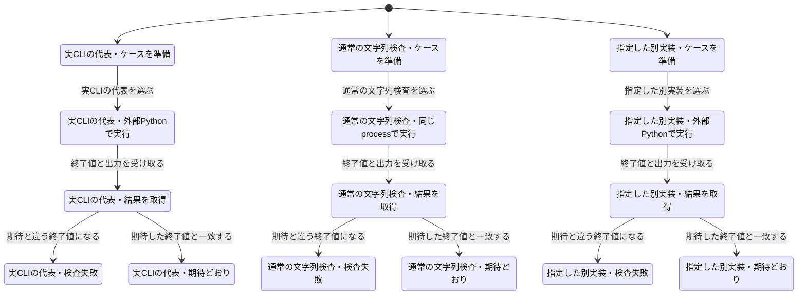

# テストの実行負荷を測る

文字列検査は、公開CLIの `main(argv)` を同じPythonプロセスで呼ぶ。引数解析、入力ファイル、policy、診断、終了値の検査は残し、ケースごとのPython起動を省く。Git境界の11ケースと、明示した `IDENTITY_GATE_SCRIPT` は実際の外部CLIで実行する。

## 保持した検査

変更前の142行は、入力全文と期待終了値で比較すると137種類だった。同じ全文・同じ期待値の5行だけを除いた。異なる表記や異なる入力をまとめて削除していない。既存137種類の入力・期待結果は一致し、代表CLIケース11件も残る。実行方式を検査する7ケースを加えたため、このテスト群の件数は153件から155件になる。

通常入力のケースでは外部Python起動が142回から0回になる。parser以下を直接呼び飛ばさず、`main(argv)` を通す。別実装の指定、指定先の不存在、終了値と出力の一致、環境復元、別実装利用時に通常実装を読み込まないことを回帰検査する。

## CIの担当範囲

リポジトリpolicy検査は専用Ubuntu/Python 3.11ジョブを主担当とする。同じUbuntu/Python 3.11での二重実行だけを除き、Ubuntu/Python 3.13とWindows/Python 3.13での互換検査は残す。全体では同じ検査の呼出しが4回から3回になる。Mac/Python 3.9を含む既存互換ジョブは維持する。

補助コードとそのテストには、対応するテストファイルを `.test-selection.json` に明示する。実装とCI設定の差分では12ファイル・未解決0件を確認した。計測・互換文書の検査を加えたPR全体は14ファイルになる。未知の依存関係を全件実行で処理せず、未解決なら停止する既存動作を維持する。

## 比較方法

`python tests/benchmark_review_tests.py --base-ref BASE --candidate-ref HEAD --samples 5 --output RESULT.json`

同じ実行環境で両版のGit treeを展開し、入力集合・成功件数・実行仕事量を確認する。監査付きwarmupは時間集計から除き、監査なしの比較をAB/BA交互に各5回行う。pytest-xdistは両版とも `-n auto`、pytestのcacheproviderは両版とも無効にする。

計測対象はこの文字列検査群と残したCLI境界であり、CI全体ではない。起動・依存導入・別の検査を含む過去のジョブ総時間と比較して、全CIの高速化率にしない。候補の最大値が比較元の最小値より小さい場合だけ、時間が短くなったと判定する。

CIではPRに `ci-benchmark` ラベルが付いた新しい実行に限り、Linux/Python 3.11で比較する。通常のCIに反復計測の費用は加えない。ラベル追加自体では実行を起動しない。

## 状態モデルと実コードの確認

有限モデルでは、通常入力・実CLI境界・指定した別実装の分岐と、終了値0/1/2/7、例外、環境復元を調べた。修正後の234状態・282遷移で行き止まり検査を含む11の規則に合格した。入力文字列の判定アルゴリズム自体を形式検証したものではない。

旧方式は最初の実行分岐で起動削減の条件に違反する。また、通常実装を先に読み込む案は初期状態で「別実装は通常実装に依存しない」「隔離した環境で読み込む」の条件に違反する。この後者は、通常実装の読み込みを失敗させた実コードの回帰テストでも再現し、必要時だけ読み込む構造へ修正した。

図は検査器の生成結果で、15状態を表示する。環境復元と終端の反復に当たる132遷移を省略している。

## CI上の測定結果

[比較計測の実行](https://github.com/nexus-ai-2045/repo-preflight/actions/runs/43482601422/job/132082810528)で、Linux/Python 3.11.18・4 CPU・xdist 4 workerを使い、監査付きwarmupの後、監査なしで各5回を交互に実行した。

| 対象 | 最小 | 中央値 | 最大 |
| --- | ---: | ---: | ---: |
| 変更前 | 8.67秒 | 9.07秒 | 11.67秒 |
| 変更後 | 5.12秒 | 5.14秒 | 5.64秒 |

この検査群の中央値は43.3%短縮した。候補の最大値も比較元の最小値より小さく、事前に定めた判定は `FASTER` だった。CI全体の短縮率ではない。

実CLI境界の起動11回とGit起動96回は両版で一致する。文字列表のPython起動は142回から0回、同じprocess内での `main(argv)` 判定は137回を観測した。全メッセージbytesと期待終了値の集合hashは、両版とも `702d6b277e14aae703d2fae5e35a61a8fd463e357d4f09da6e788ef08e45b327` で一致した。比較元は `f56ce69c841aa1ca000cbe53dfa7ca95a4c13759`、候補は `bbe69c03911dbad36b88506741f9027ec244c395`。

サンプル秒数は、変更前 `11.674100, 8.670178, 8.705906, 9.069703, 9.927408`、変更後 `5.136053, 5.115976, 5.639863, 5.142064, 5.208987`。両版ともskipなしで各反復153件・155件が成功した。

計測器はPOSIX専用で、CIではLinuxだけで実行する。Windowsでの拒否と、拒否時に成功レポートを残さないことも検査する。初回CIでエラー理由の期待値にOS差が見つかったため、Windowsでskipせず、OSに応じた正確な拒否理由を検査するよう修正した。
